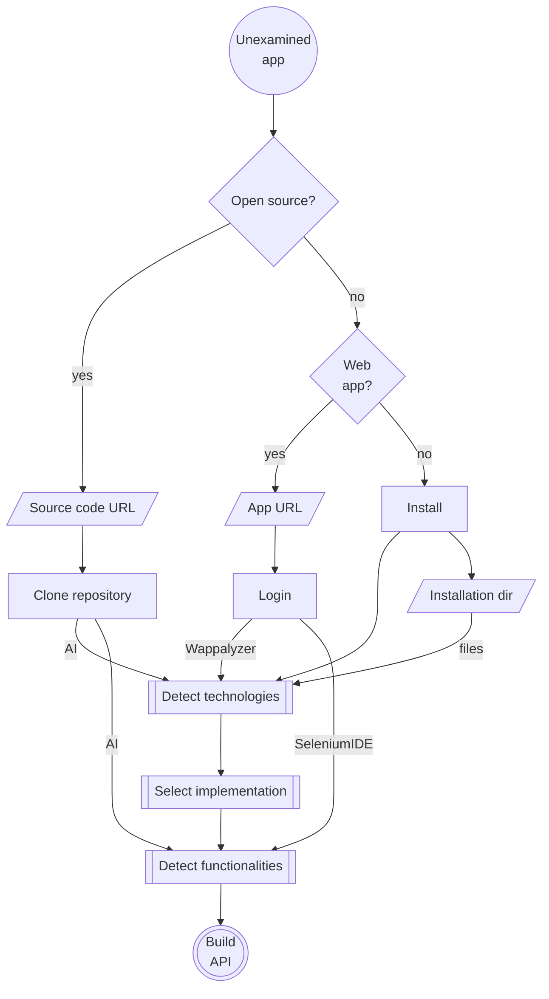

# 🐒 APIna

Framework to build API or MCP server for any UI built for humans only. Rebuilding should be easy because UI may change and break it.

## Test Cases

The API/MCP server is missing or there are many other reasons to build it:

- [Facebook Marketplace](/test/facebook-marketplace/desktop-browser.md)
- [Google Gemini](/test/google-gemini/desktop-browser.md) AI subscription doesn't include API use.
- [Google Tasks](/test/google-tasks/desktop-browser.md) ([spec](/test/google-tasks/spec.json)) [API v1](https://developers.google.com/workspace/tasks/reference/rest) is missing (eg. recurring) functionalities.
- [tori](/test/tori/desktop-browser.md) API isn't free.

## Architecture & Workflows

- [Application Specification Schema](/schema/apina-spec.schema.json)
- [Discovery Workflows](/docs/discovery-workflows.md)

## Layers

1. *User* layer is *AI* or *App*.
2. *Interface* layer  is *MCP* or *API*.
3. Business *Logic* layer is MarkDown files.
   - May be implemented in many languages.
4. *UI* semantics layer describes controls and views.
   - Abstracts UI elements.
5. *Automation* layer is the actual implementation.
   - Component framework (eg. Material Design) and theme.

## Examine process

## Implemenation selection process

