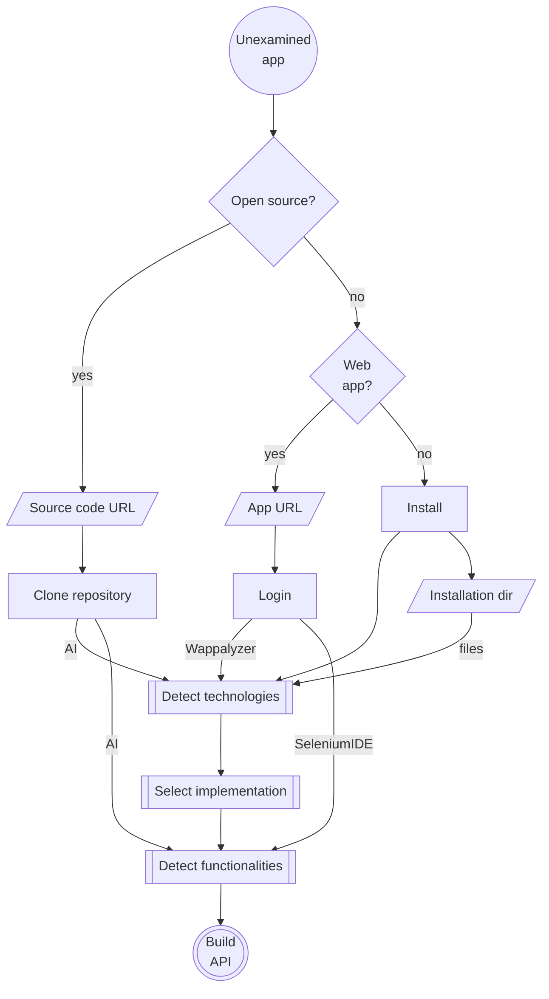
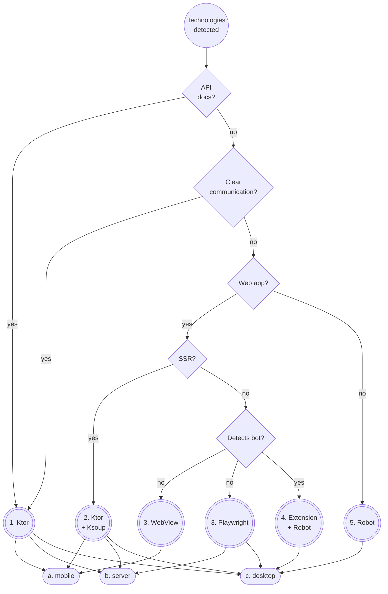

# 🐒 APIna

Build API for any UI

## Layers

1. *User* layer is *AI* or *App*.
2. *Interface* layer  is *MCP* or *API*.
3. Business *Logic* layer is MarkDown files.
   - May be implemented in many languages.
4. *UI* semantics layer describes controls and views.
   - Abstracts UI elements.
5. *Automation* layer is the actual implementation.
   - Component framework (eg. Material Design) and theme.

## Commands

- `gradlew dependencyUpdates --no-configuration-cache --no-parallel -Dorg.gradle.warning.mode=none` - Report updates
- `gradlew wrapper --gradle-version 9.7.0-rc-3 --distribution-type all` - Update Gradle wrapper
- `gradlew spotlessApply --no-configuration-cache` - Format Kotlin source

## Examine process

## Implemenation selection process

