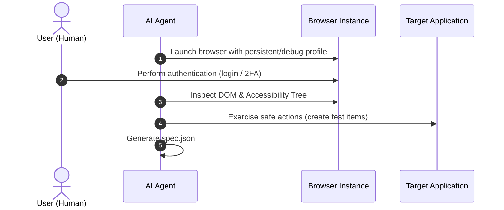
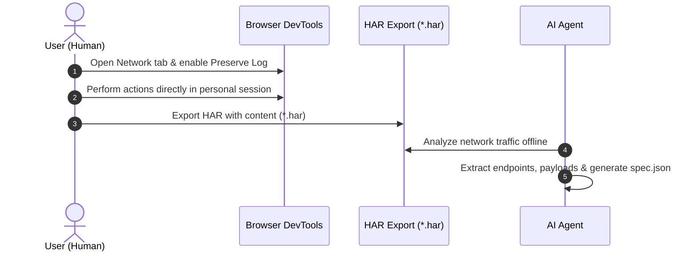

# APIna Discovery Workflows

APIna supports two discovery workflows to extract specifications from applications before generating client code or MCP tools.

## Workflow 1: Agent-Driven Interactive Exploration (Default)
Used for standard applications where the agent can safely explore and map functionality.

1. **Session initialization**: Agent launches a browser instance with an isolated debugging profile.
2. **Human authentication**: User signs in (handles 2FA/MFA or CAPTCHA).
3. **Agent exploration**: Agent navigates, queries semantic controls (`role`, `aria-label`), triggers actions, and verifies state changes.
4. **Specification output**: Agent generates `spec.json` documenting inputs, outputs, and semantic steps.

---

## Workflow 2: Human-Recorded Network Capture (Sensitive / High-Risk Apps)
Used for sensitive applications (e.g., banking, payment flows, financial transactions) where the human must retain full control over actions.

1. **Safe recording**: User operates their own personal browser and initiates DevTools Network recording (*Preserve log* enabled).
2. **Action execution**: User executes the target flow personally (e.g. executing authenticated transactions, testing listings).
3. **HAR export**: User exports network traffic via *Save all as HAR with content* to `test/<app-id>/<name>.har`.
4. **Offline analysis**: Agent inspects endpoints, RPC calls, headers, and schemas without touching live user funds or credentials.
5. **Specification output**: Agent generates `spec.json` documenting the REST/RPC protocols and payload structures.
